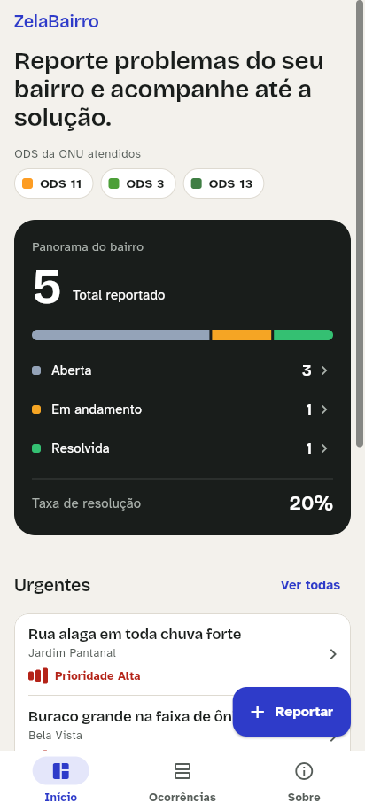
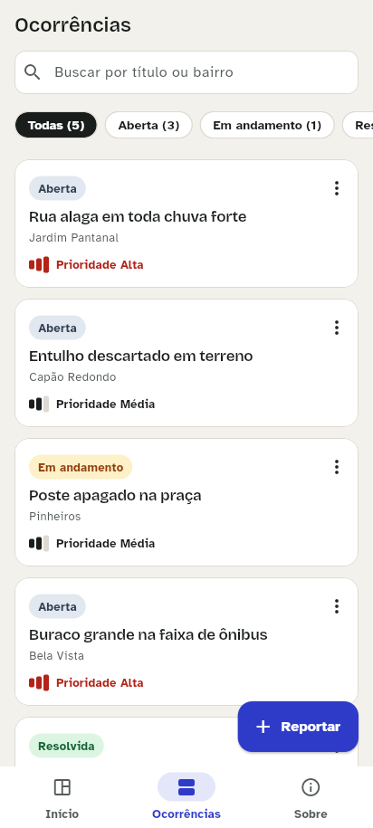
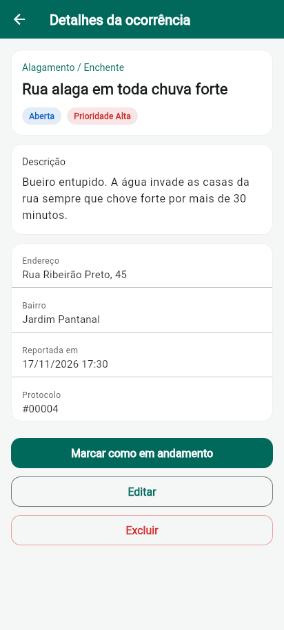
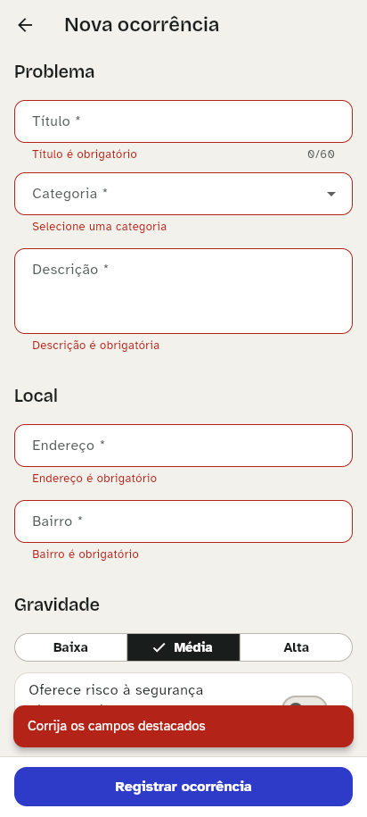
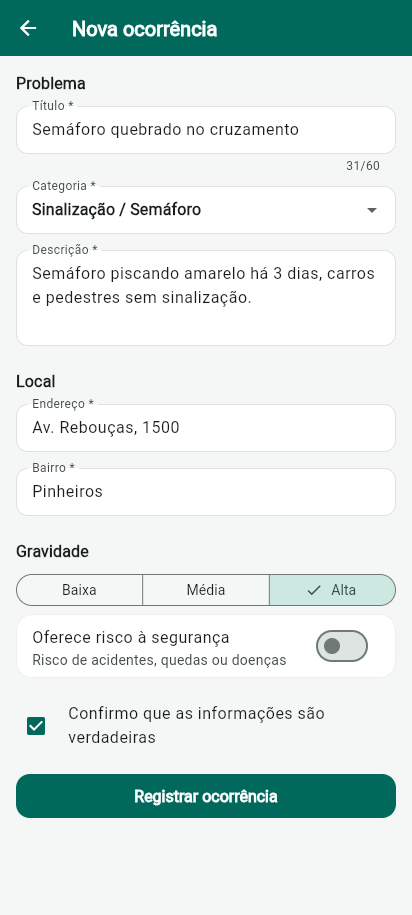
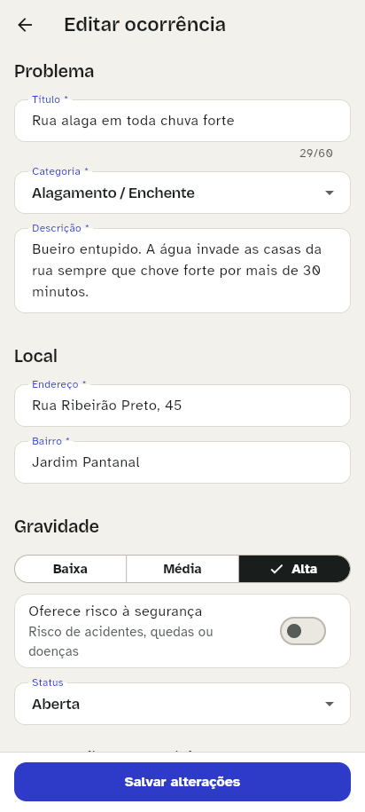
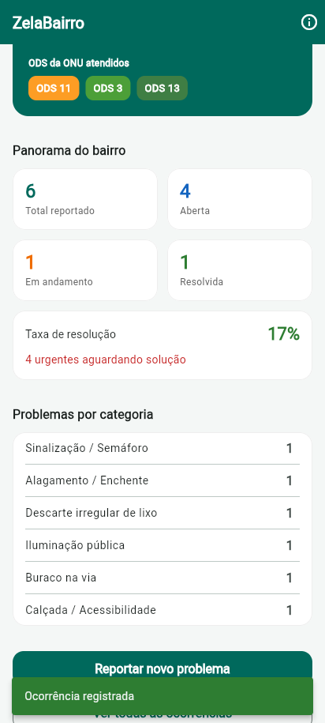
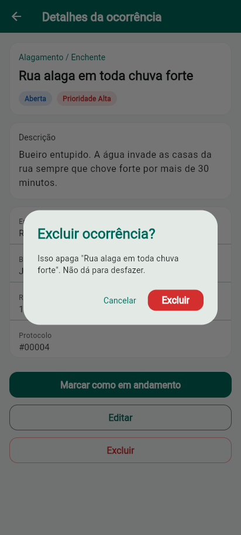
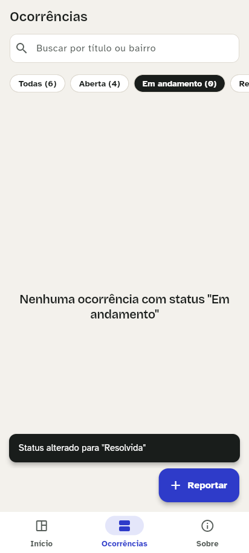
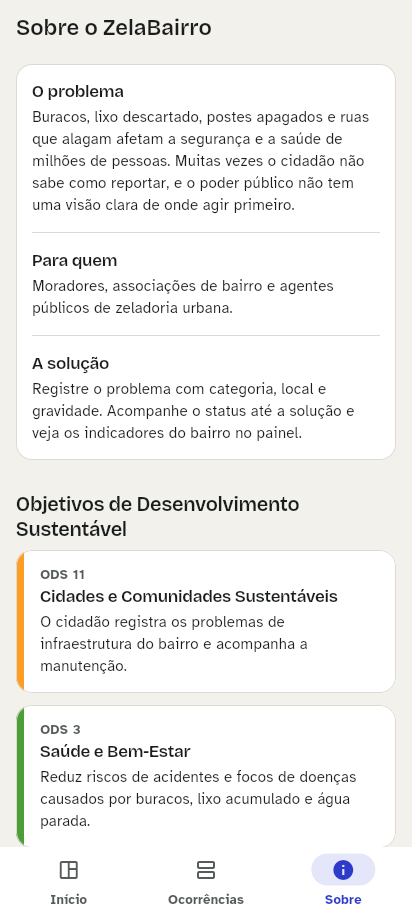

# ZelaBairro 🏙️

**Desafio FIAP CitizenTech 2026.2: "A próxima grande inovação pode estar na sua rua"**
MVP Mobile em Flutter · Disciplina: Desenvolvimento Cross-Platform com Flutter · 3º ano de Sistemas de Informação

---

## 1. Identificação

| Nome completo | RM |
|---|---|
| Leticia Rocha Fernandes Vitalino | RM552481 |

---

## 2. Sobre o projeto (CitizenTech e ODS)

### O problema real
Buracos na via, postes apagados, lixo descartado irregularmente, ruas que alagam e calçadas sem acessibilidade afetam a segurança e a saúde de milhões de pessoas todos os dias. O cidadão muitas vezes não sabe como reportar, e o poder público não tem uma visão clara de **onde** e **o que** priorizar.

### Público-alvo
- **Moradores**, que reportam e acompanham os problemas do seu bairro.
- **Associações de bairro**, que organizam as demandas da comunidade.
- **Agentes públicos de zeladoria**, que enxergam os indicadores e atualizam o status.

### Funcionalidades do MVP
- **Dashboard** com indicadores em tempo real: total, abertas, em andamento, resolvidas, taxa de resolução, ocorrências urgentes e gráfico por categoria.
- **CRUD completo de ocorrências**: criar, listar, editar e excluir (com confirmação).
- **Listagem com filtros por status**, pull-to-refresh e estados de *loading*, lista vazia e erro.
- **Formulário validado** com categoria, gravidade, risco à segurança e confirmação de veracidade.
- **Fluxo de status**: Aberta → Em andamento → Resolvida, com um toque na tela de detalhes.
- **Regra de negócio de urgência**: ocorrência não resolvida com prioridade alta **ou** risco à segurança.
- Tela **Sobre** explicando o problema, o público e os ODS atendidos.

### ODS da ONU conectados

| ODS | Como o ZelaBairro contribui |
|---|---|
| **ODS 11: Cidades e Comunidades Sustentáveis** | Dá voz ao cidadão para mapear e cobrar a manutenção da infraestrutura urbana. |
| **ODS 3: Saúde e Bem-Estar** | Reduz riscos de acidentes e focos de doenças (buracos, lixo, água parada). |
| **ODS 13: Ação Contra a Mudança Global do Clima** | Identifica pontos de alagamento para apoiar a adaptação a eventos climáticos extremos. |

---

## 3. Arquitetura e persistência escolhida

### Opção escolhida: **B, Persistência Local com SQLite (`sqflite`)**

- O banco `zela_bairro.db` e a tabela são **criados automaticamente na primeira execução** (`onCreate`).
- Já vem com **carga inicial (seed) de 5 ocorrências**, então o app abre com dados de exemplo.
- Também é possível cadastrar novos registros imediatamente pelo formulário, sem nenhuma configuração.
- Todas as operações de leitura e gravação são **assíncronas** (`Future`, `async`, `await`).

#### Estrutura da tabela `ocorrencias`

| Coluna | Tipo | Descrição |
|---|---|---|
| `id` | INTEGER PK AUTOINCREMENT | Identificador (protocolo) |
| `titulo` | TEXT NOT NULL | Título curto do problema |
| `descricao` | TEXT NOT NULL | Descrição detalhada |
| `categoria` | TEXT NOT NULL | `buraco`, `iluminacao`, `lixo`, `alagamento`, `calcada`, `sinalizacao`, `outros` |
| `endereco` | TEXT NOT NULL | Rua, número ou referência |
| `bairro` | TEXT NOT NULL | Bairro |
| `prioridade` | TEXT NOT NULL | `baixa`, `media`, `alta` |
| `status` | TEXT NOT NULL | `aberta`, `emAndamento`, `resolvida` |
| `risco_seguranca` | INTEGER NOT NULL (0/1) | Se oferece risco à segurança |
| `criado_em` | TEXT NOT NULL | Data/hora ISO 8601 |

#### Suporte por plataforma (Zero-Config)

| Plataforma | Persistência |
|---|---|
| Android, iOS, macOS | SQLite via plugin `sqflite` |
| Windows, Linux | SQLite via `sqflite_common_ffi` (o `sqlite3.dll` já é embarcado no build) |
| Web (Chrome) | Repositório em memória com a mesma interface e o mesmo seed (o navegador não tem SQLite nativo) |

A escolha da implementação é feita por **import condicional** em `lib/data/repository_factory.dart`. A UI e o Provider dependem só da interface `OcorrenciaRepository`.

### Arquitetura em camadas

```
lib/
├── main.dart                     # Injeção de dependências (MultiProvider)
├── app.dart                      # MaterialApp, tema e rotas
├── core/
│   ├── constants/ods.dart        # ODS atendidos (cores oficiais da ONU)
│   ├── routes/app_routes.dart    # Rotas nomeadas + passagem de argumentos
│   └── theme/app_theme.dart      # ThemeData (cores e tipografia padronizadas)
├── models/ocorrencia.dart        # Entidade + enums + toMap/fromMap + regras
├── data/
│   ├── ocorrencia_repository.dart          # Contrato (interface)
│   ├── database_helper.dart                # Abertura do SQLite, onCreate e seed
│   ├── sqlite_ocorrencia_repository.dart   # CRUD SQLite
│   ├── memory_ocorrencia_repository.dart   # Fallback Web / testes
│   ├── repository_factory*.dart            # Escolha por plataforma
│   └── seed_data.dart                      # Carga inicial
├── providers/ocorrencia_provider.dart      # ChangeNotifier (estado + regras)
├── screens/                      # Home, Lista, Formulário, Detalhes, Sobre
├── widgets/                      # Componentes reutilizáveis
└── utils/                        # Validators e Formatters
```

### Conceitos técnicos aplicados

| Requisito | Onde está |
|---|---|
| Widgets e layouts (Scaffold, AppBar, Column, Row, Expanded, Card, Padding, SizedBox, ListTile...) | `lib/screens/`, `lib/widgets/` |
| Componentização + `ThemeData` | `lib/widgets/`, `lib/core/theme/app_theme.dart` |
| Navegação com rotas nomeadas e argumentos | `lib/core/routes/app_routes.dart` (Detalhes recebe `id`; Formulário recebe `Ocorrencia` para edição) |
| Provider (`ChangeNotifier`, `MultiProvider`, `Consumer`, `context.watch`, `context.read`, `context.select`) | `lib/main.dart`, `lib/providers/`, todas as telas |
| `ListView.separated` + loading / vazio / erro | `lib/screens/lista_screen.dart`, `lib/widgets/feedback_states.dart` |
| `Form`, `TextFormField`, `GlobalKey<FormState>`, `validator`, `DropdownButtonFormField`, `SwitchListTile`, `Checkbox`, `SegmentedButton` | `lib/screens/formulario_screen.dart`, `lib/utils/validators.dart` |
| Feedback com `SnackBar` e `AlertDialog` | `lib/widgets/confirm_dialog.dart` |
| async/await + SQLite | `lib/data/` |

---

## 4. Galeria de telas

| Home / Dashboard | Listagem (ListView) | Detalhes |
|:---:|:---:|:---:|
|  |  |  |

| Formulário: validação | Formulário: preenchido | Formulário: edição |
|:---:|:---:|:---:|
|  |  |  |

| SnackBar após salvar (dashboard atualizado) | Confirmação de exclusão | Lista vazia (filtro) |
|:---:|:---:|:---:|
|  |  |  |

| Sobre o projeto e ODS |
|:---:|
|  |

---

## 5. Instruções de execução

**Pré-requisito:** Flutter SDK 3.35+ (Dart 3.9+) (testado com Flutter 3.44.2 / Dart 3.12). Nenhuma outra configuração é necessária: sem API, sem chaves e sem banco externo.

```bash
# 1. Clonar o repositório
git clone https://github.com/evertonrocha2/zela-bairro.git
cd zela-bairro

# 2. Instalar as dependências
flutter pub get

# 3. Rodar o app (emulador Android/iOS, Windows, macOS, Linux ou Chrome)
flutter run

# 4. Executar a suíte de testes
flutter test
```

---

## 6. Testes de unidade

São **30 testes** em `test/`, todos passando com `flutter test`:

| Arquivo | O que valida |
|---|---|
| `test/models/ocorrencia_test.dart` | Serialização `toMap`/`fromMap`, `copyWith`, valores padrão e regra de urgência |
| `test/utils/validators_test.dart` | Todas as validações do formulário e os formatadores |
| `test/providers/ocorrencia_provider_test.dart` | Carregamento com loading, CRUD, indicadores do dashboard, filtros, alteração de status e tratamento de erro |
| `test/data/sqlite_ocorrencia_repository_test.dart` | CRUD real em SQLite (em memória via `sqflite_common_ffi`), `onCreate` e seed |
| `test/widgets/telas_test.dart` | Lista vazia, formulário bloqueando dados inválidos e cadastro válido via Provider |

```
$ flutter test
00:02 +30: All tests passed!
```
